<div align="center">

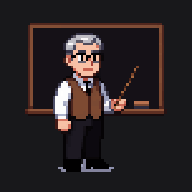

# 🎓 CPRE Studio — IREB CPRE-FL & Jornada do Herói RPG

**Estudar para a certificação IREB CPRE Foundation Level não precisa ser ler um PDF interminável.**  
Transforme **225 questões oficiais comentadas**, **simulados cronometrados**, **revisão espaçada**, **Tutor IA com RAG do Syllabus** e um **RPG tático pixel-art** na sua rotina diária de aprovação.

<p>
  
  
  
  
  
  
</p>

<p>
  
  
  
  
  
</p>

[✨ Funcionalidades](#-funcionalidades-principais) • [⚔️ Módulo RPG](#️-módulo-rpg--jornada-do-herói) • [🧠 Arquitetura](#-arquitetura--performance-local-first--swr) • [🚀 Como Rodar](#-como-rodar-localmente) • [📚 Docs](#-documentação-técnica)

</div>

---

## 💡 Por que o CPRE Studio existe?

Quem estuda para o **IREB CPRE-FL** geralmente sofre com três coisas: simulados estáticos que não mostram onde você realmente está errando, explicações rasas e falta de ritmo para revisar todo dia.

O **CPRE Studio** resolve isso unindo **ciência de aprendizagem** (revisão espaçada + fila de erros por acertos consecutivos + mapa de domínio) com **engenharia moderna** (*Local-First*, *Stale-While-Revalidate* e cascata de IAs gratuitas com RAG) e uma boa dose de **diversão** em forma de RPG pixel-art com trilha sonora chiptune sintetizada no navegador.

---

## ✨ Funcionalidades Principais

| Módulo | Rota | O que faz |
| :--- | :---: | :--- |
| 📊 **Visão Geral (Home)** | `/` | Abre em **0ms** via *Stale-While-Revalidate* (`localStorage` + cache em memória) enquanto sincroniza no Supabase. Exibe cobertura das 225 questões, taxa de acertos, sequência de dias, *"Continue de onde parou"* e *"O que estudar agora?"*. |
| 📖 **Modo Estudo** | `/estudar` | Resolução focada com gabarito ocultável, explicação oficial, **Tutor IA + RAG**, anotações pessoais, favoritas e classificação de dificuldade para revisão espaçada. |
| ⏱️ **Simulados Cronometrados** | `/simulados` | Prova real configurável por quantidade, assunto e tipo. Gabarito e explicações bloqueados no backend e frontend até finalizar, seguidos de correção completa. |
| ⚔️ **Jornada do Herói (RPG)** | `/rpg` | Campanha de 4 regiões, 40 níveis, Visual Novel, combate tático *Local-First*, baús de itens, evolução de heróis e batalhas discursivas contra Chefes avaliadas por IA. |
| 🔁 **Revisão de Erros & Espaçada** | `/revisao` | Fila inteligente que só remove uma questão errada quando você atinge a meta de acertos consecutivos, além da agenda de revisão espaçada. |
| 📈 **Relatórios & Domínio** | `/relatorios` | Gráficos temporais (Recharts), histórico de simulados e Mapa de Domínio por assunto do Syllabus IREB. |
| 🗄️ **Banco Completo & Favoritas** | `/questoes` `/favoritas` | Busca instantânea por código, enunciado, assunto, status ou questões com diagramas/imagens. |

---

## ⚔️ Módulo RPG — Jornada do Herói

> *"Você não precisa apenas decorar o Syllabus — você precisa sobreviver à Dungeon de Gelo e derrotar o Rei Congelado do Syllabus!"*

### 🗺️ As 4 Regiões e seus Chefes Discursivos

Cada região possui um **mapa DAG de 10 níveis** com bifurcações, eventos narrativos (*Visual Novel*), Fendas *Gap*, Checkpoints e um **Chefe no nível 10** que desafia você com **perguntas discursivas** avaliadas por IA + RAG do Syllabus oficial:

<table>
  <tr>
    <td align="center" width="25%">
      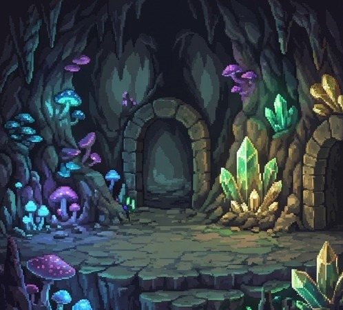<br/>
      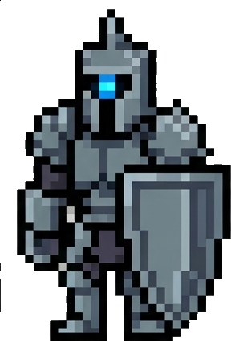<br/>
      <strong>1. Gruta Esquecida</strong><br/>
      <sub>Níveis 1–10</sub><br/>
      <em>Chefe: Arquivista de Pedra</em><br/>
      <sub>Fundamentos & Qualidade</sub>
    </td>
    <td align="center" width="25%">
      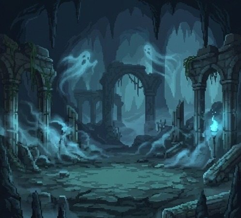<br/>
      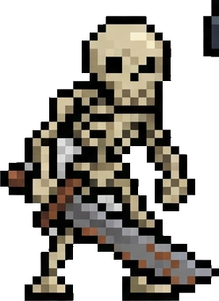<br/>
      <strong>2. Caverna Assombrada</strong><br/>
      <sub>Níveis 11–20</sub><br/>
      <em>Chefe: Espectro das Ambiguidades</em><br/>
      <sub>Elicitação & Modelagem</sub>
    </td>
    <td align="center" width="25%">
      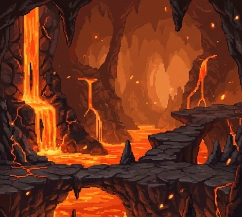<br/>
      <br/>
      <strong>3. Caverna de Fogo</strong><br/>
      <sub>Níveis 21–30</sub><br/>
      <em>Chefe: Guardião Flamejante</em><br/>
      <sub>Validação & Gerenciamento</sub>
    </td>
    <td align="center" width="25%">
      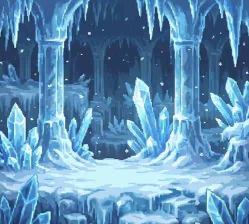<br/>
      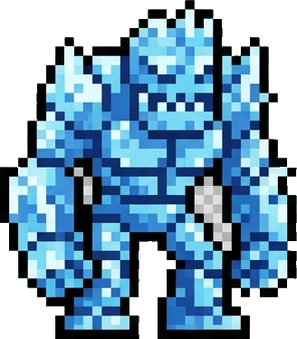<br/>
      <strong>4. Dungeon de Gelo</strong><br/>
      <sub>Níveis 31–40</sub><br/>
      <em>Chefe: Rei Congelado do Syllabus</em><br/>
      <sub>Processos & Mestria IREB</sub>
    </td>
  </tr>
</table>

---

### 🛡️ Monte seu Grupo (até 3 Heróis Equipados)

Comece com **Aldric** e desbloqueie novos heróis ao derrotar cada chefe. Distribua pontos de atributo manualmente nos Checkpoints!

<table>
  <tr>
    <td align="center" width="25%">
      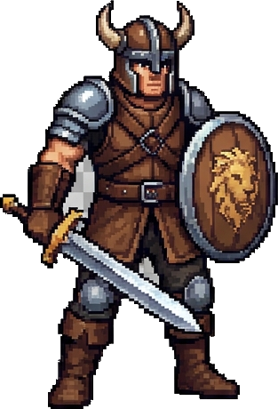<br/>
      <strong>Aldric, o Guardião</strong><br/>
      <sub>Guerreiro • Linha de Frente</sub><br/>
      <code>Passiva: Escudo do Escopo</code>
    </td>
    <td align="center" width="25%">
      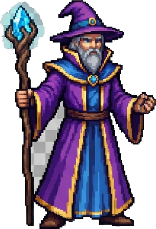<br/>
      <strong>Lyra, a Arcanista</strong><br/>
      <sub>Maga • Estratégia & Crítico</sub><br/>
      <code>Passiva: Clarividência Conceitual</code>
    </td>
    <td align="center" width="25%">
      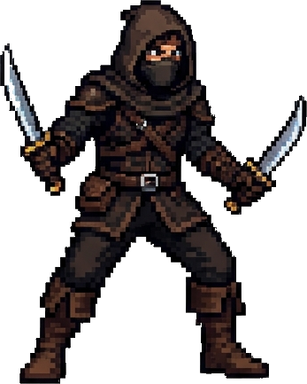<br/>
      <strong>Kael, o Sombra</strong><br/>
      <sub>Ladino • Precisão & Parry</sub><br/>
      <code>Passiva: Reflexo Crítico</code>
    </td>
    <td align="center" width="25%">
      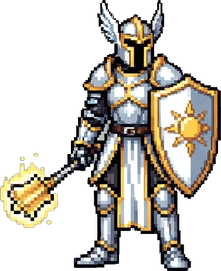<br/>
      <strong>Seraphina, a Sentinela</strong><br/>
      <sub>Paladina • Defesa & Suporte</sub><br/>
      <code>Passiva: Égide da Baseline</code>
    </td>
  </tr>
</table>

---

### 🎒 Baús de Recompensa & Arsenal IREB

Após vencer fases, escolha **1 de 3 baús** para ganhar consumíveis táticos, equipamentos e ouro:

<table>
  <tr>
    <td align="center"><br/><sub><strong>Baús Pós-Fase</strong><br/>Madeira & Ouro</sub></td>
    <td align="center">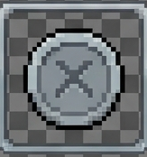<br/><sub><strong>Lente (-1)</strong><br/>Elimina 1 errada</sub></td>
    <td align="center">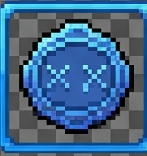<br/><sub><strong>Prisma (-2)</strong><br/>Elimina 2 erradas</sub></td>
    <td align="center">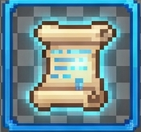<br/><sub><strong>Pergaminho</strong><br/>Recarrega Dicas</sub></td>
    <td align="center">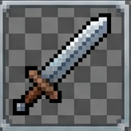<br/><sub><strong>Lâmina da Clareza</strong><br/>+Dano & Crítico</sub></td>
    <td align="center">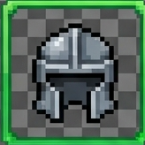<br/><sub><strong>Escudo Rastreável</strong><br/>+Defesa & Parry</sub></td>
  </tr>
</table>

<details>
<summary><strong>🎮 Clique para ver as Regras Táticas de Combate do RPG</strong></summary>

- **Baralho Aleatório de 225 Questões (Zero Repetição na Run):** todas as questões da base são embaralhadas com Fisher-Yates e rastreadas durante toda a campanha — nenhuma questão se repete até você completar as 225 na mesma run.
- **`HERO TURN` (Ataque):** acertar golpeia o inimigo alvo (com chance de crítico). Errar resulta em **MISS!** — você **não perde vida** no seu turno.
- **`ENEMY TURN` (Defesa Cronometrada):** cronômetro justo com **piso mínimo de 60 segundos (1 minuto)**. Acertar antes do tempo acabar **bloqueia 100% do ataque**!
- **Dano Proporcional em Múltipla Escolha:** em questões com 2 ou 3 respostas corretas, o dano é dividido proporcionalmente:
  - *2 corretas e acertou 1* → causa `1/2` do dano (ou sofre apenas `1/2` do dano no `ENEMY TURN`).
  - *3 corretas e acertou 1* → sofre `2/3` do dano no `ENEMY TURN` (acertou 2 → sofre apenas `1/3`).
- **Trilha Sonora Chiptune:** sintetizada em tempo real via **Web Audio API**, mudando dinamicamente entre exploração, combate normal e batalha de chefe.

</details>

---

## 🧠 Arquitetura & Performance (*Local-First* + SWR + RAG)

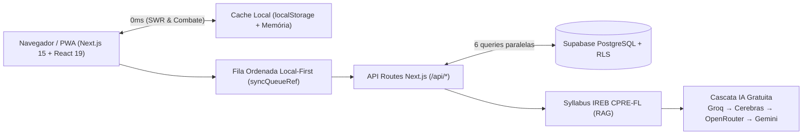

- **Visão Geral Instantânea (0ms):** hidratação imediata via *Stale-While-Revalidate* + deduplicação de queries no servidor (`cloudGetDashboardAnalytics` reduzido de 16 para **6 queries paralelas**).
- **Combate RPG Fluido (< 10ms):** avaliação instantânea no cliente com fila encadeada de sincronização (`node/select → turno 1 → turno 2 → baú`), mantendo o Supabase como fonte final da verdade.
- **Zero Dependência de IA Paga:** cascata resiliente com fallback heurístico local caso nenhuma chave de API esteja configurada.

---

## 🚀 Como Rodar Localmente

```bash
# 1. Clone o repositório
git clone https://github.com/FlipLM/ireb-cpre-studio.git
cd ireb-cpre-studio

# 2. Instale as dependências
npm install

# 3. Configure o ambiente
cp .env.example .env.local
# Preencha NEXT_PUBLIC_SUPABASE_URL, NEXT_PUBLIC_SUPABASE_ANON_KEY e (opcional) chaves de IA

# 4. Inicie o servidor de desenvolvimento
npm run dev
```

Abra **[http://localhost:3045](http://localhost:3045)** no navegador.

<details>
<summary><strong>⚙️ Variáveis de Ambiente (.env.local) & Scripts</strong></summary>

```env
# Supabase (autenticação e banco PostgreSQL na nuvem)
NEXT_PUBLIC_SUPABASE_URL=https://seu-projeto.supabase.co
NEXT_PUBLIC_SUPABASE_ANON_KEY=sua_chave_anon_ou_publishable

# Cascata opcional de IAs gratuitas (Tutor, dicas e chefes discursivos do RPG)
GROQ_API_KEY=
CEREBRAS_API_KEY=
OPENROUTER_API_KEY=
GEMINI_API_KEY=
GEMINI_MODEL=gemini-3.5-flash-lite
```

| Comando | Descrição |
| :--- | :--- |
| `npm run dev` | Inicia o app em modo desenvolvimento na porta `3045` |
| `npm run build` | Gera o build otimizado de produção (Next.js 15) |
| `npm run start` | Executa o build de produção na porta `3045` |
| `npm run typecheck` | Verificação estrita de tipos (`tsc --noEmit`) |
| `npm test` | Executa toda a suíte automatizada com **Vitest** |

</details>

<details>
<summary><strong>📁 Estrutura do Projeto</strong></summary>

```text
ireb-cpre-studio/
├── data/
│   ├── source/questoes.json                 # Base consolidada com 225 questões IREB CPRE-FL
│   └── knowledge/ireb-cpre-fl-syllabus.json # Chunks oficiais do Syllabus para RAG
├── docs/
│   ├── ARQUITETURA.md                       # Mapa completo de camadas, rotas e APIs
│   └── MODULO_RPG.md                        # Especificação técnica da Jornada do Herói
├── public/
│   ├── icons/                               # Ícones PWA (Prof. IREB pixel-art)
│   ├── media/questoes/                      # Diagramas e imagens das questões
│   └── rpg/                                 # Cenários, heróis, monstros, chefes, baús e itens
├── src/
│   ├── app/                                 # Páginas App Router + rotas de API (/api/*)
│   ├── components/                          # UI compartilhada e arena/modais do RPG
│   ├── lib/                                 # Supabase Cloud Store, IA/RAG, avaliação e engine RPG
│   ├── types/                               # Contratos TypeScript (domínio e RPG)
│   └── middleware.ts                        # Proteção de rotas e sessão Supabase
├── tests/                                   # Suíte de testes unitários (Vitest)
└── vercel.json                              # Cron job de keepalive na Vercel
```

</details>

---

## 📚 Documentação Técnica

- 🏛️ [Arquitetura Geral e Mapa de Rotas](docs/ARQUITETURA.md)
- ⚔️ [Documentação Completa do Módulo RPG](docs/MODULO_RPG.md)

---

<div align="center">
  <sub>Feito para transformar a preparação <strong>IREB CPRE-FL</strong> em uma jornada épica 🚀</sub>
</div>
